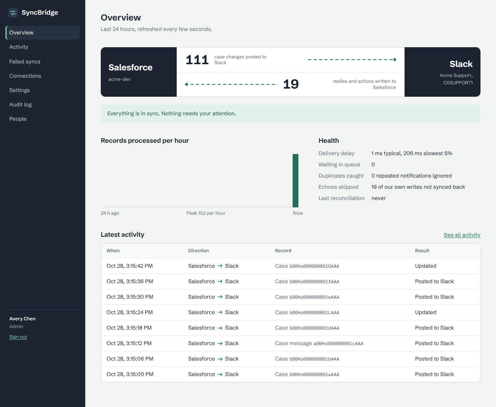
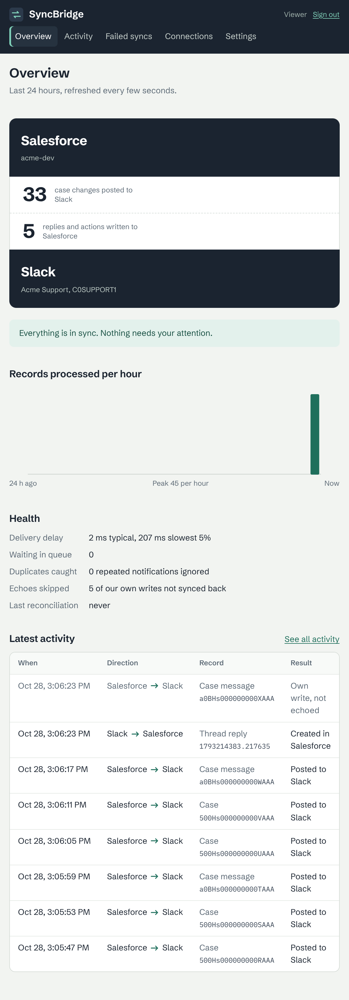
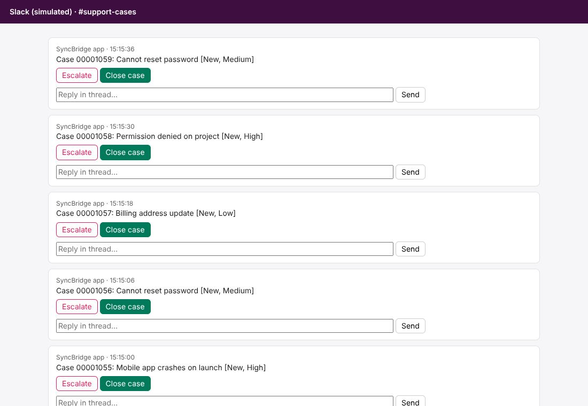

# SyncBridge: Salesforce ⇄ Slack integration with enterprise SSO

[](https://github.com/swayam16/SaaS-Integration-Platform/actions/workflows/ci.yml)


**Python · TypeScript · React · Salesforce API · Okta · SAML · SCIM · AWS Lambda**

SyncBridge keeps Salesforce Cases and a Slack support channel in step, in both directions:

- every Case gets one Slack message that updates in place as the Case changes;
- replies in the Case's Slack thread are saved to the Case in Salesforce, and agent messages
  written in Salesforce appear in the thread;
- Escalate, Close and Reopen buttons in Slack update the Case.

It runs serverless on AWS (API Gateway, Lambda, SQS, DynamoDB, KMS), connects to both apps with
OAuth 2.0, and is administered from a React console that people sign in to with **Okta SAML SSO**
and are provisioned into with **SCIM**.



## Failure test: 17,107 records, zero duplicate writes

Integrations break on retries. Salesforce resends callouts, Slack redelivers events, SQS
delivers at least once, and an API can accept a write and then time out. The failure harness runs
the real platform code against Salesforce and Slack simulators with faults injected on every
layer, then audits both sides record by record.

| | With SyncBridge's safeguards | Same run, naive retries |
|---|---:|---:|
| Records synced (10,000 Cases + messages both ways) | 17,107 | 17,107 |
| Duplicate Slack messages | **0** | 440 |
| Duplicate Salesforce records | **0** | 126 |
| Records out of date on the other side | **0** | 176 |

Faults in that run: 2,958 duplicate Salesforce webhooks, 321 lost ones, 604 Slack event retries,
661 API writes that succeeded but timed out or returned 500, 322 rate limits, a 3-minute Slack
outage, a 90-second Salesforce outage, expired tokens and 924 worker crashes in the middle of a
message. Details and the defence for each fault: [docs/failure-testing.md](docs/failure-testing.md).
CI reruns it on every push and fails on a single duplicate or mismatch.

> **Scope.** This was built and tested without live Salesforce, Slack or Okta tenants: the
> simulators reproduce the API endpoints, status codes, signatures and retry behaviour SyncBridge
> uses, and the SAML tests use Okta-shaped signed assertions. The Apex trigger and the AWS
> template are written for real orgs and accounts (the template passes `cfn-lint`) but have not
> been deployed from this repository yet.

## How duplicates are prevented

1. **Idempotency keys** based on what an event means (`sf:Case:<id>:<SystemModstamp>`,
   `slack:msg:<channel>:<ts>:<edit>`), claimed with DynamoDB conditional writes and leases.
2. **Per-record locks** and **version guards** so concurrent and out-of-order events can't
   overwrite newer data.
3. **Idempotent writes**: Salesforce upserts by external ID; Slack posts are reserved before
   sending and found again through **message metadata** if the response is lost.
4. **Retries** with full-jitter backoff and `Retry-After`, **circuit breakers**, a **dead-letter**
   view with safe replay, and a **reconciler** that recovers lost webhooks.

More in [docs/architecture.md](docs/architecture.md).


## Enterprise sign-in

- **SAML 2.0** service provider for Okta: signature verification against the pinned certificate,
  protection against XML signature wrapping, comment-truncated NameIDs, replays, wrong
  audience/recipient/issuer, expired or unsolicited assertions, DTDs and XXE, each with a test.
- **SCIM 2.0** Users and Groups (filters, paging, Okta and Entra ID PATCH styles). Okta groups
  become console roles (admin, operator, viewer); deactivating someone in Okta ends their
  sessions immediately.
- Server-side sessions, CSRF protection, audit log, KMS envelope encryption for OAuth tokens.

| Console on a phone | Simulated Slack channel (local dev) |
|---|---|
|  |  |

## Customer documentation

- [Setup guide](docs/setup-guide.md): AWS deploy, Salesforce connected app and trigger, Slack app,
  Okta SAML and SCIM, verification, operations, troubleshooting
- [Security FAQ](docs/security-faq.md): data handled and retained, encryption, authentication,
  authorization, monitoring
- [Architecture](docs/architecture.md) and [diagram](docs/architecture.svg)

## Run it locally

Needs Python 3.12+ and Node 22. No cloud accounts needed.

```bash
python -m venv .venv && source .venv/bin/activate
make install
make dev            # http://localhost:8080
```

`make dev` starts the console, the API, a mock Okta and simulated Salesforce and Slack in one
process, with four demo users already provisioned over SCIM. Sign in as Avery (admin), Jordan
(operator) or Sam (viewer); Riley is deactivated and gets refused. Then change a Case at
`/_sim/salesforce/ui` and reply or press a button at `/_sim/slack/ui` to watch both directions sync.

```bash
make test           # 78 Python tests + console tests
make chaos          # the 10,000-case failure test with the naive baseline (about 2.5 minutes)
make lint           # ruff, TypeScript, cfn-lint
```

## Deploy to AWS

```bash
make deploy DOMAIN=sync.example.com CERT_ARN=arn:aws:acm:us-east-1:...:certificate/... \
  ALARM_EMAIL=ops@example.com
```

Then follow the [setup guide](docs/setup-guide.md) to connect Salesforce, Slack and Okta.

## Repository

```
src/syncbridge/
  sync/            engine (exactly-once logic), worker, reconciler
  salesforce/      OAuth 2.0 (PKCE, refresh, JWT bearer), REST client, webhook verification
  slack/           OAuth v2, Web API client with metadata recovery, Events/interactivity, Block Kit
  saml/            SAML service provider, Okta-shaped mock IdP for development
  scim/            SCIM 2.0 server and filter parser
  admin/           console API, sessions, audit log
  store/           DynamoDB and in-memory stores with conditional writes
  sim/             Salesforce and Slack simulators, failure harness, report
  handlers.py      Lambda entry points
console/           React + TypeScript admin console (Vite)
salesforce/        Apex trigger and notifier, Case_Message__c, permission set (SFDX)
slack/             Slack app manifest
infra/             AWS SAM template: API Gateway, Lambda, SQS + DLQ, DynamoDB, KMS, CloudFront
tests/             SAML attacks, SCIM, engine scenarios, AWS via moto, end-to-end console API
```

## License

MIT
