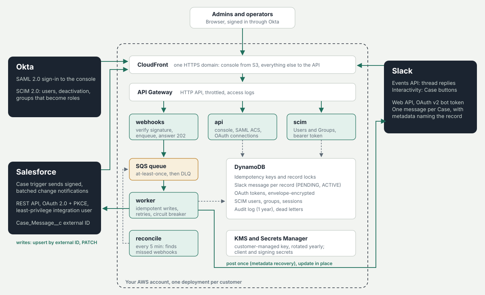

# SyncBridge setup guide

This guide takes you from an empty AWS account to Salesforce Cases syncing with a Slack channel,
with your team signing in through Okta. Plan on about an hour, most of it in the Salesforce, Slack
and Okta admin screens.



## What you need

| | Who | Used for |
|---|---|---|
| AWS account and a region | Cloud admin | Runs SyncBridge (Lambda, SQS, DynamoDB, CloudFront) |
| A hostname, e.g. `sync.example.com`, and an ACM certificate for it in **us-east-1** | Cloud admin | One HTTPS address for the console and every endpoint |
| Salesforce System Administrator | Salesforce admin | Deploys the trigger and custom object, creates the connected app |
| Slack workspace admin (or app-approval rights) | Slack admin | Creates and installs the Slack app |
| Okta Super Admin or App Admin | Identity admin | SAML sign-in and SCIM provisioning |

Everywhere below, replace `sync.example.com` with your hostname.

## 1. Deploy to AWS

Requires the AWS CLI, the AWS SAM CLI, Python 3.12 and Node 22.

```bash
git clone <this repository> && cd syncbridge
make install
make deploy DOMAIN=sync.example.com \
  CERT_ARN=arn:aws:acm:us-east-1:111122223333:certificate/abcd... \
  ALARM_EMAIL=ops@example.com REGION=us-east-1
```

When the stack finishes:

1. Create a DNS `CNAME` from `sync.example.com` to the `CloudFrontDomain` stack output.
2. Note the `SecretsArn` output. Every setting from the steps below goes into this one secret,
   in the AWS console under **Secrets Manager → (secret) → Retrieve secret value → Edit**.

Two values you generate yourself:

```bash
openssl rand -hex 32          # SALESFORCE_WEBHOOK_SECRET (also goes into Salesforce, step 2)
syncbridge scim-token         # prints a SCIM token for Okta and its SCIM_TOKEN_SHA256
```

Put `SALESFORCE_WEBHOOK_SECRET` and `SCIM_TOKEN_SHA256` in the secret. Keep the SCIM token itself
for step 4; SyncBridge only stores its hash.

## 2. Salesforce

### Deploy the trigger and object

With the Salesforce CLI, from the `salesforce/` folder:

```bash
sf org login web --alias prod
sf project deploy start --target-org prod --test-level RunSpecifiedTests \
  --tests SyncBridgeNotifierTest
```

This adds:

- **Case Message** (`Case_Message__c`), a child of Case for messages written in Salesforce or
  synced from Slack. `Slack_Message_Key__c` is a unique external ID, so one Slack message can
  never become two records.
- **Last Slack Actor** on Case: who last pressed a button on the Case's Slack message.
- **CaseSyncTrigger** and **CaseMessageSyncTrigger**, which queue signed notifications to
  SyncBridge without slowing down saves.
- The **SyncBridge Integration** permission set (read and edit Cases, create and edit Case
  Messages, nothing else, no delete).

Then:

1. **Setup → Named Credentials → SyncBridge**: set the URL to `https://sync.example.com`.
2. **Setup → Custom Settings → SyncBridge Settings → Manage → New** (organisation level):
   paste `SALESFORCE_WEBHOOK_SECRET` into Webhook Secret and tick Enabled.
3. Add the **Case Messages** related list to your Case page layout.

### Integration user and connected app

1. Create a user for SyncBridge (the Salesforce Integration user license works) and assign the
   **SyncBridge Integration** permission set.
2. **Setup → App Manager → New Connected App**:
   - Enable OAuth settings. Callback URL: `https://sync.example.com/oauth/salesforce/callback`
   - Scopes: *Manage user data via APIs (api)* and *Perform requests at any time
     (refresh_token, offline_access)*
   - Tick **Require Proof Key for Code Exchange (PKCE)**
   - Under **Manage → Edit Policies**: Permitted users *Admin approved users are
     pre-authorized*, add the integration user's profile or permission set; Refresh token policy
     *Refresh token is valid until revoked*.
3. Copy the consumer key and secret into the AWS secret as `SALESFORCE_CLIENT_ID` and
   `SALESFORCE_CLIENT_SECRET`. For a sandbox, set `SALESFORCE_LOGIN_URL` to
   `https://test.salesforce.com`.

## 3. Slack

1. Open `slack/manifest.yaml`, replace `sync.example.com` with your hostname, then go to
   <https://api.slack.com/apps> → **Create New App → From an app manifest** and paste it.
   The app asks only for `chat:write`, `channels:history`, `groups:history` and `users:read`.
2. Copy the **Client ID**, **Client Secret** and **Signing Secret** from *Basic Information* into
   the AWS secret as `SLACK_CLIENT_ID`, `SLACK_CLIENT_SECRET` and `SLACK_SIGNING_SECRET`.
3. Create or pick the support channel and invite the app: `/invite @SyncBridge`.
4. Note the channel ID: open the channel's details; it is at the bottom and starts with `C`
   (or `G` for a private channel).

## 4. Okta

### Sign-in (SAML)

**Applications → Create App Integration → SAML 2.0**, name it SyncBridge, then:

| Field | Value |
|---|---|
| Single sign-on URL | `https://sync.example.com/saml/acs` (use it for Recipient and Destination) |
| Audience URI (SP Entity ID) | `https://sync.example.com/saml/metadata` |
| Name ID format | EmailAddress |
| Application username | Email |
| Attribute statements | `email` = `user.email`, `firstName` = `user.firstName`, `lastName` = `user.lastName` |
| Group attribute statement | `groups`, filter *Starts with* `SyncBridge` |
| Response / Assertion signature | Signed / Signed, RSA-SHA256 (Okta's defaults) |
| Assertion encryption | Unencrypted (encrypted assertions are rejected) |

On the app's **Sign On** tab, open the metadata and copy into the AWS secret:

- `SAML_IDP_ENTITY_ID`: the `entityID` attribute, e.g. `http://www.okta.com/exk1abcd...`
- `SAML_IDP_SSO_URL`: the HTTP-Redirect `SingleSignOnService` location
- `SAML_IDP_CERT`: the signing certificate, as PEM (`-----BEGIN CERTIFICATE-----` ...)

Sign-in starts from the console. Okta dashboard tiles (IdP-initiated sign-in) are refused by
default because they can't be tied to a login request; set the Lambda environment variable
`SAML_ALLOW_IDP_INITIATED=true` if you want them.

### Provisioning (SCIM)

1. On the app's **General** tab, set *Provisioning* to **SCIM**.
2. **Provisioning → Integration**: SCIM connector base URL `https://sync.example.com/scim/v2`,
   unique identifier field `userName`, supported actions *Push New Users*, *Push Profile Updates*
   and *Push Groups*, authentication mode *HTTP Header*, and paste the SCIM token from step 1.
   **Test Connector Configuration** should pass.
3. **Provisioning → To App**: enable *Create Users*, *Update User Attributes* and
   *Deactivate Users*.
4. Create three groups and assign them to the app, then push them (**Push Groups**):

| Okta group | Console role | Can |
|---|---|---|
| SyncBridge Admins | Admin | Everything, including connections, settings, audit log, people |
| SyncBridge Operators | Operator | Watch the sync, retry failed syncs, run a reconciliation |
| SyncBridge Viewers | Viewer | Watch the sync |

Only people provisioned through SCIM can sign in. Deactivating someone in Okta signs them out of
the console immediately; moving them between groups changes their role on their next request.

## 5. Apply the settings and connect

```bash
make reload STACK=syncbridge REGION=us-east-1
```

Then open `https://sync.example.com`, sign in as an admin and:

1. **Connections → Connect Salesforce**, and approve as the integration user.
2. **Connections → Connect Slack**, and allow the app in your workspace.
3. **Settings → Slack channel**: paste the channel ID and save.

The overview should now say *Everything is in sync*.

## 6. Check it end to end

1. Create a Case in Salesforce. It appears in the Slack channel within a few seconds.
2. Change its status or priority. The same Slack message updates; nothing new is posted.
3. Reply in the message's thread. The reply appears on the Case as a Case Message.
4. Press **Escalate** in Slack. The Case's status and priority change in Salesforce.
5. Add a Case Message in Salesforce. It appears as a reply in the Slack thread.

Each step shows up on the console's **Activity** page.

## Day to day

- **Failed syncs**: records SyncBridge gave up on after repeated retries (for example, the app was
  removed from the channel). Fix the cause, then **Retry**; retrying never writes twice.
- **Alarms** (if you set `ALARM_EMAIL`): messages in the SQS dead-letter queue, the queue falling
  more than 10 minutes behind, worker errors.
- **Pausing for a data load**: untick *Enabled* in SyncBridge Settings in Salesforce. When you tick
  it again, the reconciler (every 5 minutes) catches up on the changes made in between.
- **Rotating secrets**: change the value at the source (Salesforce, Slack, Okta or the SCIM token),
  update the AWS secret, run `make reload`. For the webhook secret, update Salesforce and AWS
  within five minutes of each other.
- **Upgrading**: `git pull && make deploy ...` with the same parameters.

## Troubleshooting

| Symptom | Likely cause |
|---|---|
| Okta shows an error after sign-in, console says *Sign-in failed* | Certificate, entity ID or SSO URL in the secret doesn't match Okta's metadata, or `make reload` wasn't run. The audit log has the exact reason. |
| *Your account has not been provisioned* | The user isn't assigned to the app in Okta, or provisioning hasn't run yet. |
| Cases don't appear in Slack | Named Credential URL or webhook secret mismatch (webhooks return 401 in the API Gateway access logs); app not invited to the channel (shows under Failed syncs as `not_in_channel`). |
| Slack replies don't reach Salesforce | Event Subscriptions URL not verified in the Slack app, or the reply was outside a Case thread. |
| *Salesforce unreachable, retrying* on the overview | Salesforce API errors or limits; syncing resumes on its own when the circuit breaker's probe call succeeds. |

## Removing SyncBridge

1. In the console, disconnect Salesforce and Slack (this revokes both tokens).
2. Delete the Slack app and the Salesforce connected app; deactivate the Okta app.
3. `sam delete --stack-name syncbridge`. The DynamoDB table is retained and protected from
   deletion so data isn't lost by accident: turn off deletion protection and delete it to remove
   all stored data. Schedule the KMS key for deletion last.
